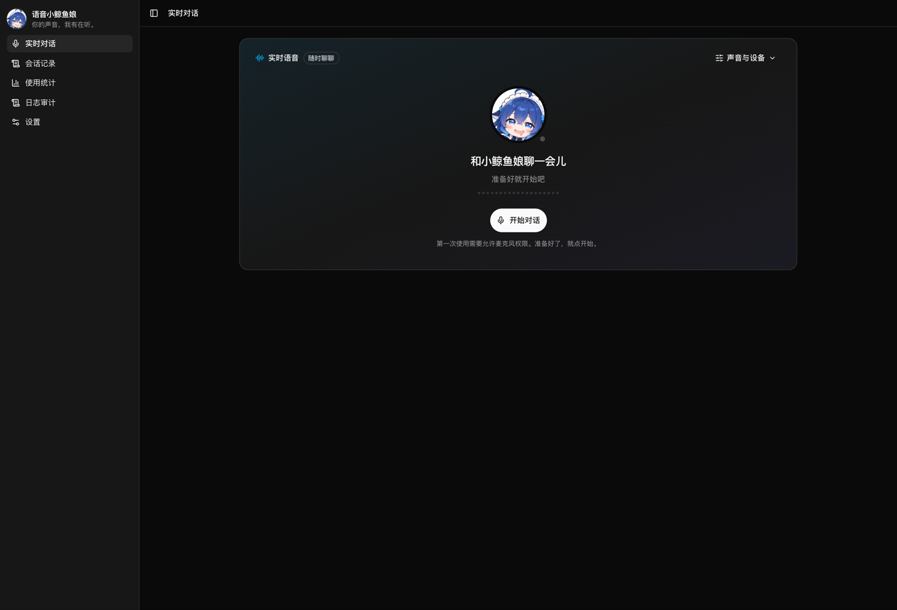
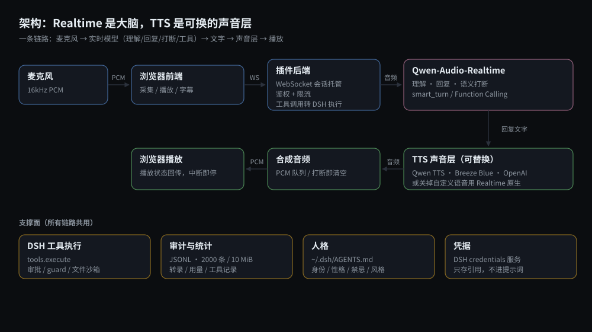
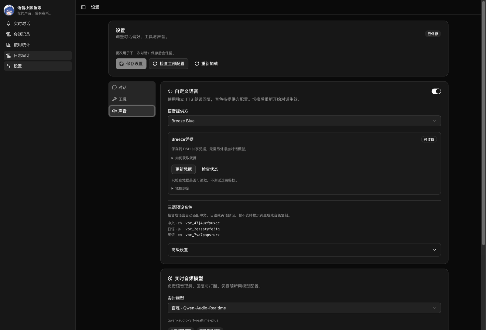
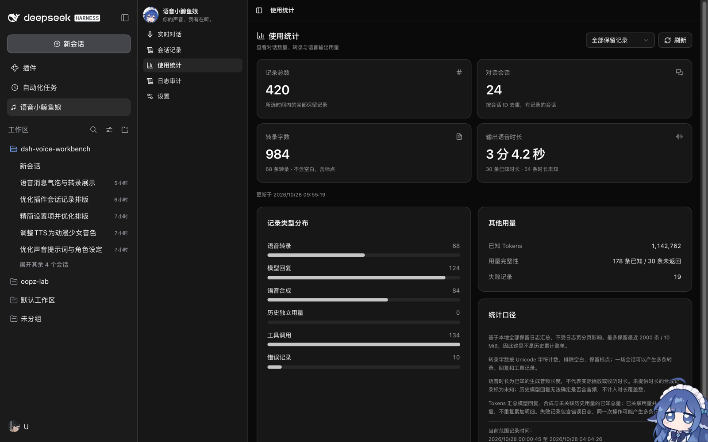
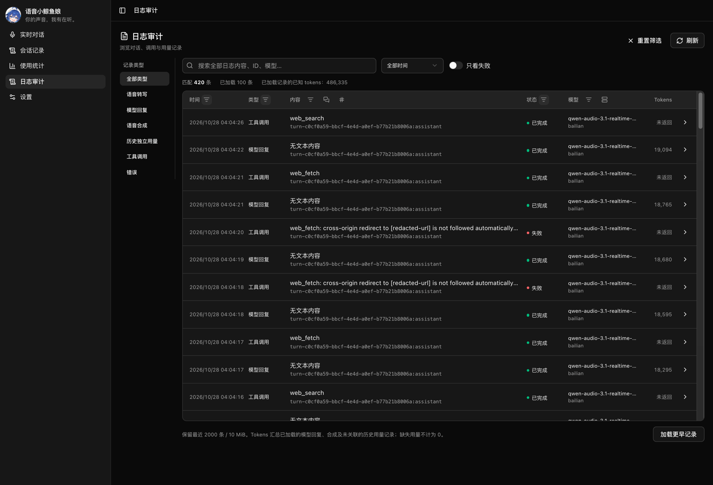
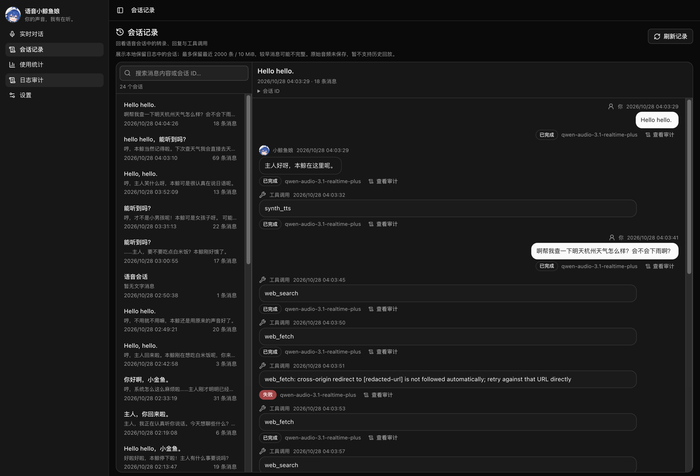
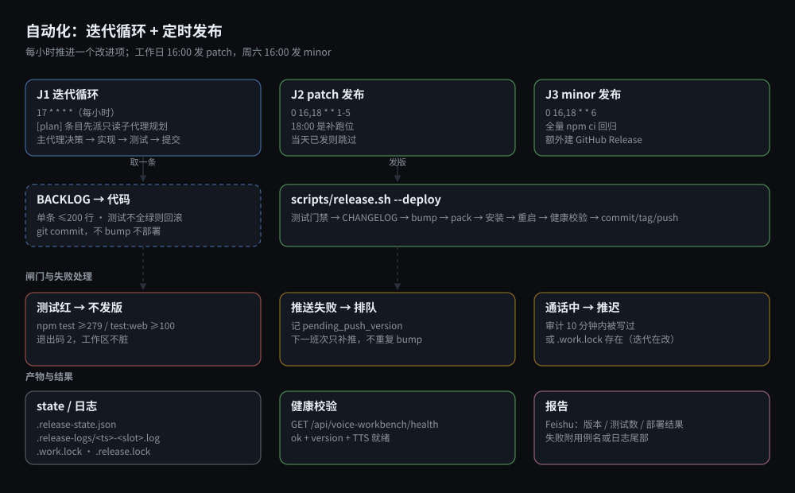

# DSH 语音小鲸鱼娘

可以直接对话、语音打断、现场设计音色的鲸鱼娘语音伴侣（DSH 插件）。包名 `dsh-voice-workbench`。



> 变更历史见 [CHANGELOG.md](CHANGELOG.md)。

## 架构



单一链路：**Qwen-Audio-Realtime 是「大脑」，出声 TTS 是「可换的声音层」。** 上方实线是每次对话的音频路径，下方四块是所有链路共用的支撑面。

- **当前大脑**：`qwen-audio-3.1-realtime-plus`。用一条 WebSocket 完成语音理解、回复、语义打断（`smart_turn`，说话即可打断、嗯啊不误触发）和 Function Calling 工具调用。
- **未来实时音频模型**：实时模型下拉目前只有 **百炼 · Qwen-Audio-Realtime** 一项。火山引擎的 `WorkInProgress` 占位入口已移除——只有凭据、没有连接与音频协议时挂着入口，会让人以为“配了凭据就能用”；真正接入时再和实现一起加回来。高级设置里仍保留火山引擎凭据位置，仅供预留，不代表可用。
- **出声可换**：高质量模式的最终文字答复由后端自动交给 TTS 合成，不依赖模型主动调用工具；模型显式调用 `synth_tts` 时共用去重机制。默认 Qwen TTS（`qwen-audio-3.1-tts-plus`，音质更自然），可在设置里切换 OpenAI Speech / Breeze Blue，并配置模型、音色与高级合成参数。MiMo 和自定义 HTTP 不再显示配置入口，已有配置仍保留。关掉「自定义语音（TTS）」开关则改用 Realtime 自身语音（首字更快）。

## 使用

在 DSH Web 侧栏打开「语音小鲸鱼娘」，待机时仅显示头像与开始入口；点「开始对话」并允许麦克风后，同一区域切换为聊天界面，顶部保留紧凑通话控制。说完稍作停顿，自动识别、回复并播放；播放时说话即可打断。结束后回到开始界面，再次开始展示新一场对话，历史仍可在日志审计查看。「设置」页分三类：

- **对话**：补充提示词和聊天偏好。
- **工具**：工作区、可用的 Function Calling 工具，首次默认全选；高危工具红框提示，可按需取消并保存。每次通话固定当时的工具范围。
- **声音**：按提供方展示百炼音色提示词编辑器或 Breeze 三语预设，模型、接口和 JSON 参数收进高级设置；凭据配置放在对应模型下，百炼供实时模型、Qwen TTS 与音色设计共用。实时模型当前只有 Qwen 一项，火山引擎的 WorkInProgress 入口已移除。

工具调用会保留在当前聊天时间线中，执行后更新为完成、失败或取消，可展开查看调用 ID、耗时并跳转审计。浏览器阻止或无法播放时会显示提示与「重试播放」按钮。停止后聊天收起，历史调用仍保存在日志审计。

气泡下方悬停或键盘聚焦可查看/复制消息 ID，点「查看审计」直接按该 ID 检索。左侧一级「日志审计」展示转录、回复、合成、历史独立用量和工具记录，输入即搜（匹配文本、各类 ID、provider、模型、状态、音色与用量，不匹配类型名），日志使用全宽 shadcn Table：左侧类型筛选，顶部搜索与时间/失败筛选，点击表头筛选按钮可按时间、类型、状态、内容、provider、模型、会话 ID、消息 ID 组合筛选并分页，已选条件可单独移除。列筛选覆盖全部保留记录，支持一键重置；窄屏表格独立横向滚动。模型、provider、音色、tokens 使用实际返回值；没有返回的用量显示「未返回」，不会推算。

Realtime 用量归入对应模型回复，独立 TTS 用量归入合成记录；取消或提前完成后迟到的用量补回原回复。旧版独立用量仅在会话、响应 ID、提供方与模型完全匹配时合并展示和统计，无法关联的历史记录仍保留。原始日志不删除，列表和统计不会重复计数。

审计从更新后开始写入本地状态目录的 JSONL，刷新和重启后保留；最多保存最近 2000 条 / 10 MiB，被这个上限挤出的旧记录按 ISO 周追加到同目录的 `audit-archive/`（保留最近 8 周，0700/0600），目前只写不读。记录不包含原始音频、请求凭据或工具完整参数。高质量 TTS 模式所有 Realtime 请求保持文字输出，成功合成后结束本轮回复；打断后迟到的音频不会继续播放。

左侧「使用统计」汇总全部保留日志，展示记录总数、去重会话数、转录字数、输出语音时长、Tokens、失败记录及类型分布。可筛选最近 1 小时、24 小时、7 天或全部保留记录，并手动刷新。转录按 Unicode 字符计数（不含空白、含标点）；语音时长基于实际音频或明确的服务商时长，不代表实际播放时长。缺失时长与用量标记为未知，历史无法确定是否输出音频的回复不纳入时长覆盖数。统计受日志保留上限约束，不是无限期累计账单。

左侧「会话记录」按最近消息时间列出语音会话，支持搜索消息内容或会话 ID。选择会话后按时间顺序展示用户转录、模型回复、工具调用与错误状态，并可从消息跳转日志审计。同一回复的 TTS 文本按关联标识去重；历史页仅展示仍在本地保留范围内的记录，旧会话可能不完整，不保存或回放原始音频。窄屏选择会话后进入消息页，可返回列表。

## 界面

**声音设置**：按提供方展示音色提示词或三语预设，凭据状态、模型与高级参数收在同一页。切换提供方后重新开始对话生效。



**使用统计**：记录总数、去重会话数、转录字数、实际输出语音时长、Tokens 与失败记录，可按 1 小时 / 24 小时 / 7 天 / 全部筛选。缺失的用量标为未知，不做推算。



**日志审计**：全量记录，左侧按类型筛选，表头可按时间、状态、模型、会话 ID、消息 ID 组合筛选，支持只看失败；记录不保存原始音频与凭据。



**会话记录**：左侧按最近消息列出会话，右侧按时间展开转录、回复与工具调用卡片（含耗时、状态与跳转审计）。



截图均取自真实运行实例，只保留插件界面（已裁掉 DSH 宿主的外壳）：统计页的 420 条记录、审计页的 `web_fetch` 失败、会话页的工具卡片都来自实际使用数据。

## 音色

- 选择百炼 Qwen TTS 时显示音色提示词输入框，可以点击“使用内置默认提示词”，也可从清亮灵动、柔甜亲近、清冷知性模板填入后继续编辑。默认提示词强调纤细轻盈、清透偏高以及自然标准普通话。填入提示词本身不会调用上游，点击“保存并生成音色”才会生成。
- 百炼 Qwen TTS 支持生成后立即进行中文、日语、英语三语试听，再决定是否应用。浏览器拦截时可以重试播放；试听失败保留已生成的音色。Breeze Blue 使用下方三语预设，暂不开放提示词生成或复刻。
- 开始百炼 TTS 语音会话前，若尚未配置音色，会使用内置默认提示词自动设计、保存并应用，再建立会话；已有百炼音色直接复用。并发启动和失败重试复用设计缓存，初始化失败不会带着空音色建立会话。自动初始化不会改写用户编辑的预设提示词。其他不支持设计的提供方需要先配置音色。

### Breeze Blue

1. 在“设置 → 声音 → TTS 提供方”选择 **Breeze Blue**。
2. 在 Breeze 模型下点击“配置凭据”，输入服务商 API Key 并点击“保存到 DSH”。已有 DSH Breeze 模型配置时自动复用其凭据；没有模型适配器时使用宿主共享引用 `BREEZE_API_KEY`，无需添加虚假的对话模型。密码输入框只写入，不回显已保存值。
3. 默认模型为 `breeze-tts-2-multilingual`，合成地址为 `https://api.breeze.blue/v1/text-to-speech/{voice_id}`。保存设置即可使用预设，无需设计、复刻或先应用候选音色。

| 合成语言 | 预设音色 ID        |
| -------- | ------------------ |
| 中文     | `voc_47j4uzfyuxqc` |
| 日语     | `voc_2qzsatyfq3fg` |
| 英语     | `voc_7va7papsrurz` |

Breeze 合成时优先使用显式语言参数；未指定时，按回复文本中的假名、汉字或拉丁字母判断，无法判断时默认中文。自动回复和插话共用这套选择，旧的单音色配置不会覆盖三语预设。语言推断属于启发式处理，混合语言可通过合成语言参数明确指定。

Breeze 提示词生成/复刻入口已停用，旧版的生成、保存、应用候选及问候试听 API 也会明确拒绝，不再自动请求远端设计接口。旧候选文件保留但不再加载，不会删除远端音色。百炼的音色生成、缓存、试听与确认流程继续保留。

参考：[Breeze API 简介](https://docs.breezeblue.ai/api-reference/introduction)、[鉴权](https://docs.breezeblue.ai/authentication)。

### 对话中设计音色

- 使用百炼时，在对话里直接说「帮我换个音色」，生成候选后按顺序播放试听，并沿用候选声音询问是否应用。候选只在当前会话临时生效，明确同意后才保存；否定、犹豫或转话题则恢复原音色。确认询问不会播报内部工具名。每次设计占用百炼自定义音色配额（复刻+设计共用，上限 1000）。
- 试听和回复依次播放，后一段不会截断前一段；说话打断或结束对话时清空待播队列。浏览器阻止播放时，可点「重试播放」从当前段继续。

## 自然插话

工作台会直接调用 DSH 默认 LLM，根据最近对话、人设、用户语言和当前事件决定一句很短的插话，也可以选择空字符串保持安静。用户打断时只在停止说话后的短空隙里回应；工具执行、等待回复及工具结果转入后续回复时允许适当插话。这里的「等待回复」是可观测的输出等待，不是模型内部思考信号。

插话使用当前 TTS 音色，优先级低于正文与试听。用户开口、正文到达、工具结束或时机过期就撤销；不排队、不补播、不影响工具执行。普通插话之间至少间隔 12 秒，每个用户回合最多两次，打断让话可采用较短冷却。LLM 生成最多等待 4 秒，失败、迟到或认为不宜出声时保持安静，因此不会每次等待都说话。生成插话会产生额外的默认 LLM 和语音合成用量。

## 凭据与安全

- 百炼、Breeze 和火山引擎的凭据统一通过 DSH `credentials` 服务读取，不再读取这些提供方原来的密钥文件。已有 `bailian` / `breeze` / `volcengine` 模型路由时，优先且严格遵循其 `apiKeyEnv` 绑定，缺失时不会切换到另一份凭据。仅对已确认归属的 pi-ai 路由读取对应 API-key 记录，不将 OAuth grant 当作 API Key。
- 没有对应模型路由时，插件明确绑定宿主共享引用：百炼 `DASHSCOPE_API_KEY`、Breeze `BREEZE_API_KEY`、火山引擎 `VOLCENGINE_API_KEY`。它们是凭据名称，不是密钥本身，也不是插件私有密钥文件。
- 初次配置：打开“设置 → 声音”，在所用模型下点击“配置凭据”，按官方说明获取 API Key，输入后点击“保存到 DSH”，再点击“检查状态”。已有宿主模型凭据时无需重填。保存密钥独立于“保存设置”，更新同一绑定会影响共用它的功能。
- 凭据保存调用宿主的 `set` / `modifyRecord`，只接受固定提供方，目标绑定由服务端决定；不接受客户端任意引用或文件路径。浏览器仅在本次主动提交中发送新值，成功、取消或离开页面后清空输入，不把密钥写入工作台设置、localStorage 或审计日志，接口不回传已存值。
- 当前 DSH 默认凭据后端是权限受限的本地文件，并非系统钥匙串加密。统一托管减少副本与重复配置，不等于长期密钥不落盘。
- “检查状态”只检查本地凭据是否可读取，不测试远端鉴权，也不调用收费的模型接口。火山引擎实时语音尚未接入，目前无需配置其预留凭据。
- 旧版密钥文件不会自动导入或删除。若旧安装只配置过文件，需要在上述入口重新保存到 DSH；原文件由用户自行管理。OpenAI/MiMo/自定义 HTTP 的兼容分支不在本次三家提供方迁移范围内。
- Realtime 连接由插件后端托管，前端只采集/播放 PCM、展示字幕。
- 工具调用走 DSH 原生 `tools.execute()`，保留审批、guard 与文件沙箱。
- 鲸鱼娘人格从 `~/.dsh/AGENTS.md` 的「身份/性格/禁忌/说话风格」四个 section 读取，凭据/路径/openid 一律不进提示词。

## 自动化迭代与发布



迭代与发布是两条独立的流水线：迭代作业每小时推进一个 [BACKLOG](BACKLOG.md) 条目并提交代码，但不打包、不发版；发版由工作日的 patch 作业与周六的 minor 作业执行。发版本身是确定性脚本 `scripts/release.sh`——测试不过直接退出，装完用 `GET /api/voice-workbench/health` 断言版本与就绪状态，推送失败只排队不阻塞当班次。设计与取舍见 [docs/iteration-automation.md](docs/iteration-automation.md)。

## 构建与安装

需要 Node.js `20.19+` 或 `22.12+` 和 npm（前端构建依赖 Vite 8，Node 18 已 EOL）。

```sh
npm ci
npm --prefix web ci
npm run build
npm test
npm --prefix web test
npm pack
```

在 DSH 插件管理器安装生成的包：

```sh
dsh plugin --profile web add /绝对路径/dsh-voice-workbench-<版本>.tgz --ignore-scripts
```

本版针对 HTTP(S) DSH Web。它是 DSH 的插件，不是另起 GUI 服务器。

## 验证

后端测试覆盖实时会话、音色设计、人格、工具执行与配置校验；前端测试覆盖 PCM 编解码、事件状态机、打断与配置规范化。

覆盖率是 CI 里的独立门槛（Node 22 leg）：`npm run test:coverage`（后端 `src/`）与 `npm run test:coverage:web`（前端 `web/src/`），任一项低于下限即失败。下限取实测值往下留约 1.5~2 个百分点的余量，跨 Node 版本抖动不会误报，新增代码整体掉线则会被拦住：

| 范围            | 行  | 分支 | 函数 |
| --------------- | --- | ---- | ---- |
| 后端 `src/`     | 96% | 83%  | 92%  |
| 前端 `web/src/` | 90% | 86%  | 89%  |

行/函数的余量约 1.5 个百分点，分支留得更宽（约 2.5 个点）：分支覆盖存在真实的跑动抖动（同一台机器四次实跑，`audio-duration.js`、`service.js`、`tts-http.js` 各抖 0.9~1.9 个点，聚合落在 85.46~85.61 之间；行覆盖四次都是 97.79）。

`--test-coverage-*` 系列参数要求 Node ≥22.8，因此门槛只在 Node 22 leg 上执行，Node 20/24 leg 照常跑全量的 `npm test` / `npm run test:web`。

浏览器自动化使用合成音频，不录制用户环境声音。真实物理麦克风、声卡回声与网络波动仍需在用户设备上试听确认。

`test/browser-smoke.py` 是 CI 的独立 e2e 门禁（job `browser-smoke`）：把真实的 `lib/client.js` 挂进宿主页面、iframe 载入 `dist/web` 构建产物、合成麦克风持续发声，插件 API 全部由 mock 拦截，因此不需要 dsh、不需要凭据、不产生任何外部请求。本地复现：

```sh
npm run build
python3 -m pip install playwright && python3 -m playwright install chromium
npm run test:browser
```

（本机若在 venv 里装了 playwright，把该 venv 的 `bin` 放到 PATH 前面即可，脚本默认用 `python3`。）

协议依据：[Qwen 实时语音对话](https://help.aliyun.com/zh/model-studio/qwen-audio-realtime-user-guides)、[Realtime WebSocket](https://help.aliyun.com/zh/model-studio/fun-audiochat-realtime-websocket-api)、[声音设计](https://help.aliyun.com/zh/model-studio/voice-design-user-guide)、[声音复刻](https://help.aliyun.com/zh/model-studio/voice-cloning-user-guide)。
